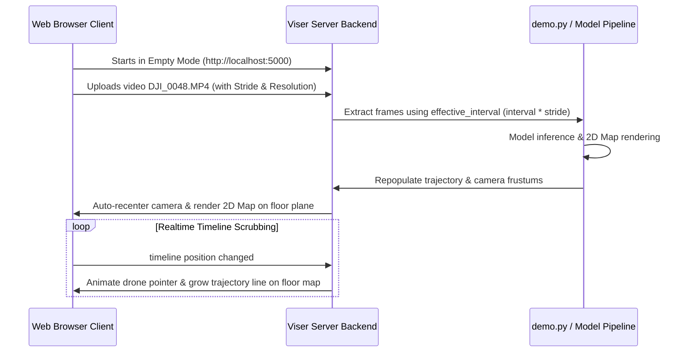

# Code Modifications & Optimization Report

This document outlines all the modifications made to the `lingbot-map` codebase to enable optimized 2D Sparse Mapping, dynamic video uploading, and interactive, real-time 3D camera trajectory tracking in Viser.

---

## Required Packages

To run the 2D map sparsing and video processing, the following key packages must be installed:
* **`opencv-python`** (`cv2`): Used to extract/save video frames, and render the grid floor map (drawing wedges with `cv2.fillPoly`, trajectories with `cv2.polylines`, and camera points with `cv2.circle`).
* **`viser`**: The main WebGL visualization server.
* **`numpy`**: For array transformations and coordinate projections.
* **`matplotlib`**: Generates the color gradient map for camera pose visualizations.
* **`torch`** (PyTorch): Handles the model loading and inference on GPU/CPU.

---

## 1. Key Modifications by File

### 1. [`demo.py`](file:///d:/Drone%20Projects/lingbot-map/demo.py)
* **Direct Empty Startup Mode**: Added a fallback check at startup. If neither `--image_folder` nor `--video_path` is supplied, the script bypasses checking for frames and directly starts the Viser server in empty mode (`PointCloudViewer(pred_dict=None)`).
* **Frame Extraction Optimization**: Modified `load_images` to calculate the `effective_interval = interval * stride` before decoding video frames. Rather than writing every frame to disk as a JPEG and filtering later (which was extremely slow), the script now extracts and saves **only the exact frames that will be used for mapping**.
* **Zero-Lag Frame Decoding**: Updated the frame extraction loop to use `cap.grab()` instead of `cap.read()` for skipped frames. This prevents OpenCV from decoding unused frames, resulting in a 5x speedup for video load processing.

---

### 2. [`lingbot_map/vis/point_cloud_viewer.py`](file:///d:/Drone%20Projects/lingbot-map/lingbot_map/vis/point_cloud_viewer.py)
* **Unlocked 360° Perspective Camera View**: Removed the strict top-down orthographic camera locking behavior. Connected clients are initialized with a `perspective` camera pointing at a 3D offset angle (preventing Gimbal Lock) to allow users to zoom, orbit, and pan 360 degrees around the map.
* **Hiding Camera Frustums by Default**: Disabled the default rendering of 3D coordinate frames and frustum squares along the camera path by setting `show_camera = False` in the constructor to clean up the workspace.
* **Orientation Alignment Correction**: Rotated the flat 2D floor map plane `/2d_map` by 180 degrees around the vertical Z-axis so it is not shown upside down relative to the user's default viewport.
* **Dynamic Timestep Sync**: Integrated `self._update_bev_scene_image(current_timestep)` directly inside the timeline's slider update listener (`gui_timestep.on_update`). When the timeline plays or scrubs, the 2D floor map plane `/2d_map` updates dynamically to animate the drone's position pointer and trajectory path.
* **Dynamic GUI Controls**: Added sidebar controls for uploading new videos, custom strides (up to `10`), and resolutions (`256`, `384`, `518`).
* **Direct PNG Download**: Modified the map export button to encode the 2D map directly to a PNG buffer and trigger a native file download in the browser client instead of trying to write to the server's local filesystem.
* **Empty-State Safety Checks**: Patched timeline sliders, play buttons, and point cloud list readers to handle an empty state (`pred_dict=None` on startup) cleanly without throwing `NoneType` errors.

---

## 2. Interactive Workflow Diagram

The sequence below illustrates how the modified system handles dynamic video uploads and updates the 2D Sparse Map:

